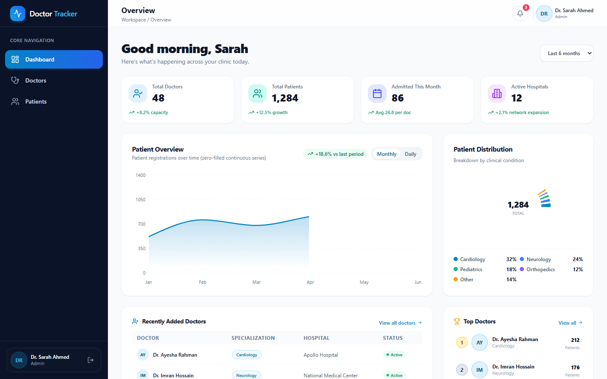
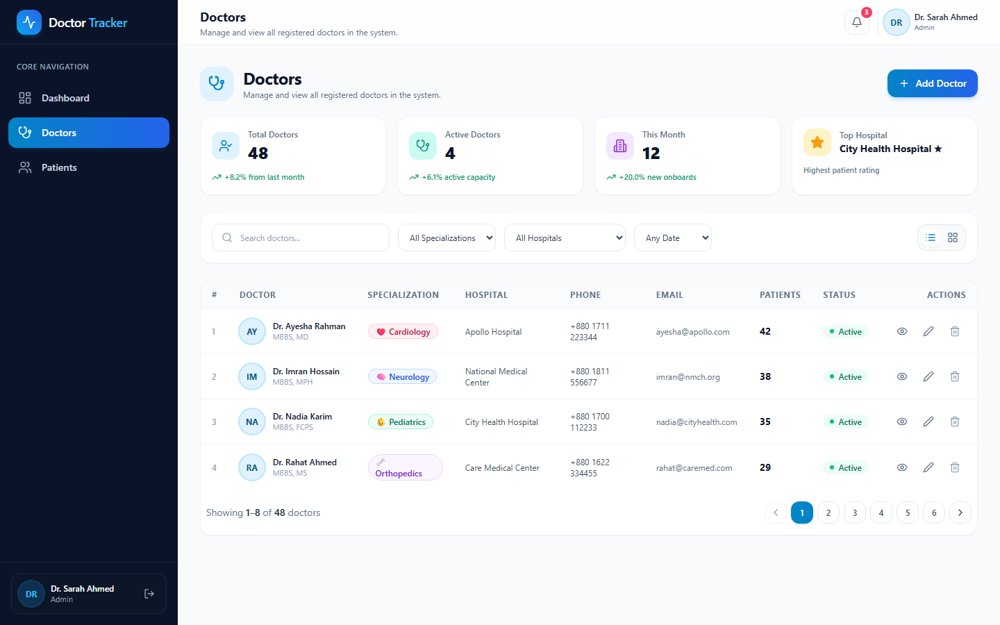
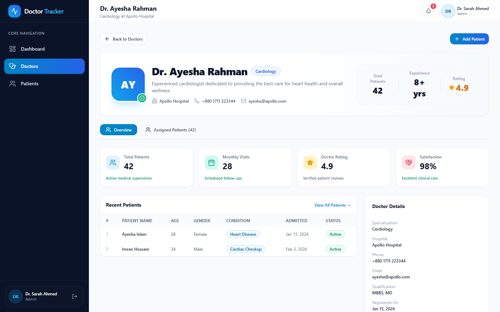
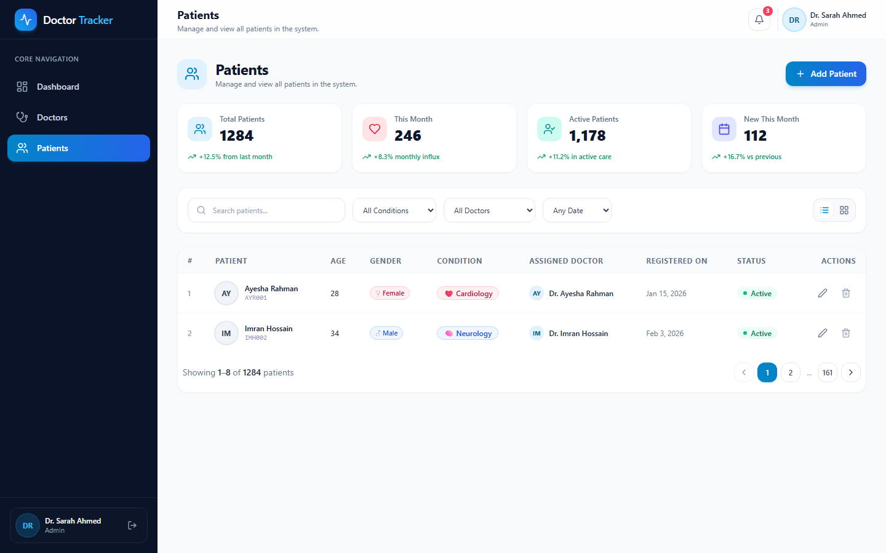
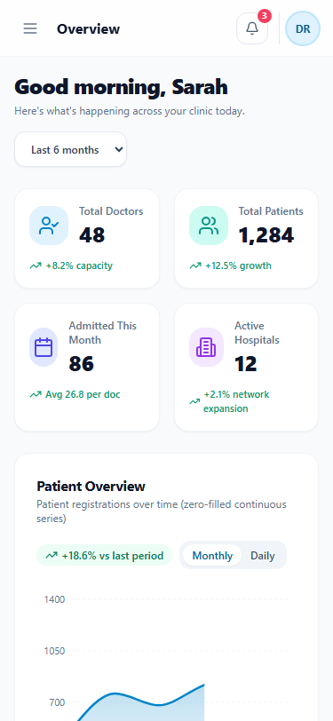
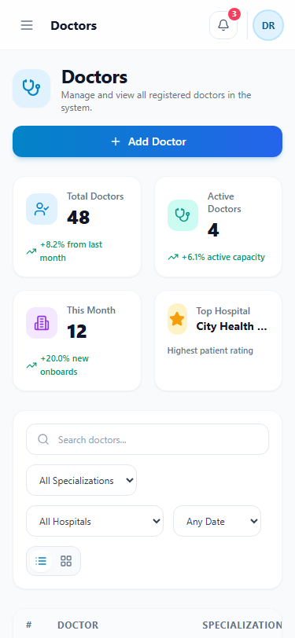
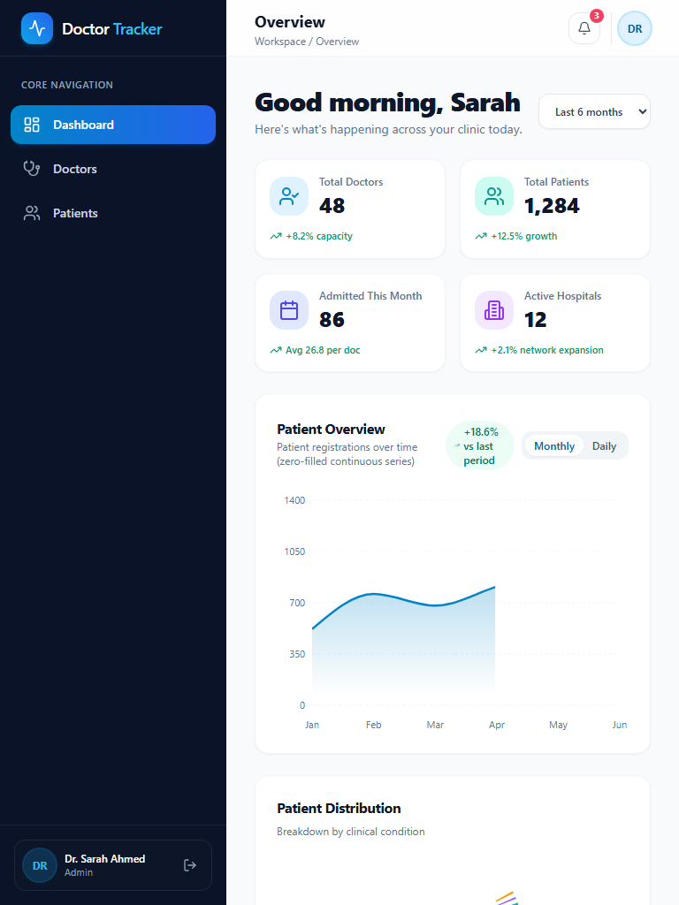
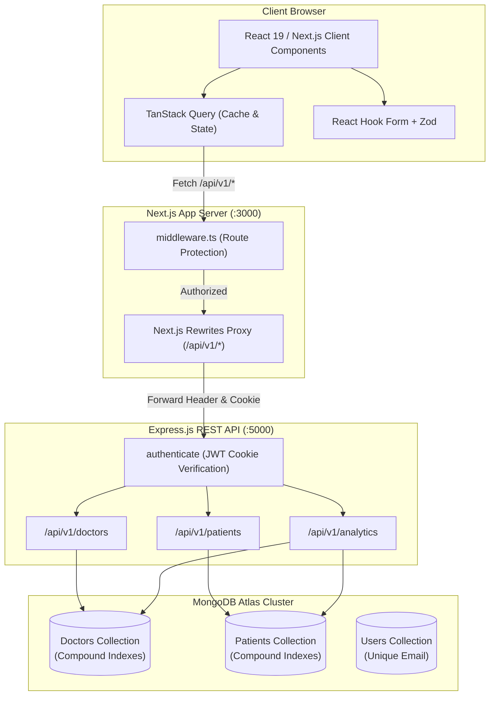

# Doctor Tracker - Frontend

> Modern, high-performance healthcare administration web application built with Next.js 15 (App Router), TypeScript, Tailwind CSS, TanStack Query, and Recharts.

Doctor Tracker provides clinic administrators and healthcare coordinators with a unified command center to manage doctors, track admitted patients, schedule treatments, and monitor organizational health metrics through responsive, interactive data visualizations.

---

## 📸 Visual Showcase

### Analytics Dashboard & Overview


### Doctor Directory & Profile Management
| Desktop Directory | Detail & Patient Roster |
|:---:|:---:|
|  |  |

### Dedicated Patients Roster


### Responsive Mobile & Tablet Experience
| Mobile Dashboard | Mobile Doctors List | Tablet View |
|:---:|:---:|:---:|
|  |  |  |

---

## 🏗️ System Architecture

Doctor Tracker employs a decoupled client-server architecture. All browser requests communicate through Next.js proxy rewrites to maintain first-party cookie semantics while enabling independent deployments.



---

## 💡 Technical Deep Dives

### 1. First-Party `httpOnly` JWT Authentication via Server Proxy
**The Challenge:** Cross-site cookies (`SameSite=None; Secure`) are increasingly blocked by modern browser privacy features (Apple Safari ITP, Google Chrome third-party cookie restrictions), leading to silent session dropouts when frontend and backend reside on separate subdomains. Storing JWTs in `localStorage` or `sessionStorage` exposes sensitive access tokens to Cross-Site Scripting (XSS) vectors.

**Our Solution:**
1. The backend issues an `httpOnly`, `SameSite=Lax`, `Secure` cookie named `dt_auth_token`.
2. In `next.config.mjs`, all `/api/v1/:path*` requests are transparently rewritten to `http://127.0.0.1:5000/api/v1/:path*` (or the internal backend URL in production).
3. Because the browser communicates exclusively with the Next.js origin, the session cookie is strictly **first-party**. JavaScript running in the browser cannot read or exfiltrate the token, eliminating XSS token theft.
4. `middleware.ts` inspects incoming route requests at the Edge. Unauthenticated visitors attempting to view `/dashboard`, `/doctors`, or `/patients` are redirected to `/login` before rendering occurs.

### 2. High-Performance Query Architecture & Analytics Aggregation
**The Challenge:** Healthcare platforms handle dense relational queries (e.g. "Find all Cardiology patients admitted under doctors in Apollo Hospital within Q1"). Naive MongoDB querying causes full collection scans (`COLLSCAN`) and memory-heavy application-level array filtering.

**Our Solution:**
1. **Compound Schema Indexing:** Declared indexed prefixes matching common filter patterns:
   - `{ specialization: 1, createdAt: -1 }` and `{ hospital: 1, createdAt: -1 }`
   - `{ doctor: 1, createdAt: -1 }` and `{ condition: 1, createdAt: -1 }`
   - Regex name searches utilize index prefix bounding, verified via `.explain('executionStats')` to achieve 100% `IXSCAN` coverage.
2. **Database-Level Aggregation:** Dashboard metrics compute in a single `$facet` pipeline. Top doctors leaderboard joins patients via `$lookup` with `$group`, eliminating N+1 query overhead.
3. **Continuous Timeline Zero-Filling:** The analytics engine groups admissions into time buckets (`7d`, `30d`, `6m`, `1y`) and programmatically backfills inactive intervals with `{ count: 0 }`, preventing truncated or misleading chart visualizations in Recharts.

---

## 🛠️ Tech Stack

- **Framework:** Next.js 15.5 (App Router, React 19)
- **Language:** TypeScript 5.7 (Strict mode)
- **Styling & UI:** Tailwind CSS, Lucide React, Sonner (Toasts)
- **State & Data Fetching:** TanStack Query v5 (automatic query invalidation, caching, stale-while-revalidate)
- **Form Management:** React Hook Form + Zod (type-safe validation schema)
- **Data Visualization:** Recharts (Responsive Container, Area/Line Timeline, Donut Distribution)
- **Testing:** Playwright E2E suite (responsive viewport testing across desktop, tablet, and mobile)

---

## 🚀 Getting Started

### Prerequisites
- Node.js >= 20.x
- Backend API running on `http://127.0.0.1:5000` (see `Doctor Tracker Back`)

### Installation

```bash
# Clone the repository
git clone https://github.com/TheLunatic1/Doctor-Tracker-Front.git
cd Doctor-Tracker-Front

# Install dependencies
npm install

# Configure environment
cp .env.example .env.local
```

### Environment Variables (`.env.local`)
```env
NEXT_PUBLIC_API_URL=/api/v1
NEXT_PUBLIC_APP_URL=http://localhost:3000
BACKEND_INTERNAL_URL=http://127.0.0.1:5000
```

### Development & Build Commands

```bash
# Start Next.js development server
npm run dev

# Run TypeScript type check
npm run typecheck

# Run ESLint validation
npm run lint

# Create production build
npm run build

# Start production server
npm start

# Run Playwright End-to-End tests
npx playwright test
```

---

## 🌐 Live Web Application

- **Live URL:** [https://toha.tail2c2947.ts.net:8443](https://toha.tail2c2947.ts.net:8443)

## 🔐 Authentication Credentials

- **Email:** `admin@doctortracker.com`
- **Password:** `Admin123456!`

---

## 📄 License
MIT © Doctor Tracker Engineering
